# APU Automotive Service Centre (APU-ASC)

A Java desktop application that runs a car service centre: customers are registered, appointments are booked and assigned to technicians, payments and receipts are recorded, and managers follow the business through reports. It has four roles (Manager, Counter Staff, Technician and Customer), each with its own screens.

Built for a Java Object-Oriented Programming assignment (Year 2, Semester 1) at Asia Pacific University (APU), with **Java Swing** for the interface and **plain text files** for storage, so there is no database to install.

## Features

### Manager
- Add, edit, search and delete Managers, Counter Staff and Technicians (one screen is reused for all three)
- Set the price of each service
- Read feedback written by technicians and comments written by customers
- View **7 analytical reports**: revenue breakdown, technician performance, counter staff performance, service popularity, customer activity, appointment status and monthly revenue
- Delete safeguards: a manager cannot delete their own account or the last manager, and a technician with active appointments cannot be deleted

### Counter Staff
- Create, edit, search and delete customers; a default username and password are generated for each new customer
- Book appointments (Normal Service, 1 hour, or Major Service, 3 hours), and filter them by status
- Assign a technician, with only technicians who are free at that time shown
- Collect payments for assigned appointments and generate numbered receipts

### Technician
- Dashboard with assigned, pending and completed counts
- Search and filter assigned tasks, view the details and mark tasks as completed
- Submit feedback on completed tasks, one per appointment
- See an upcoming schedule sorted by date and time, and read customer comments

### Customer
- View and edit their profile
- See their service history and payment history
- Read the technician's feedback for each appointment
- Leave a comment for the technician and the counter staff who handled an appointment, once per staff member for each appointment

## Screenshots

### Login
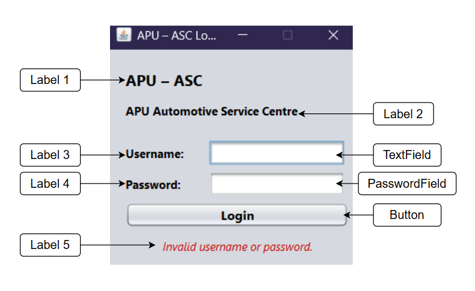

### Manager

| | |
|---|---|
| 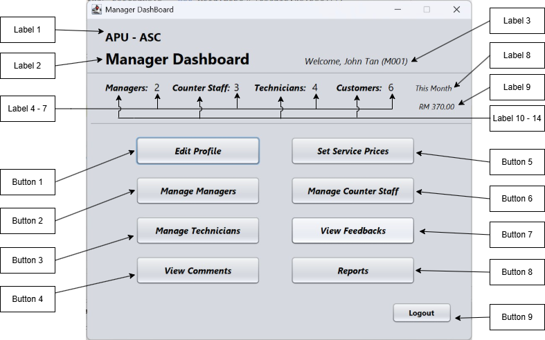 | 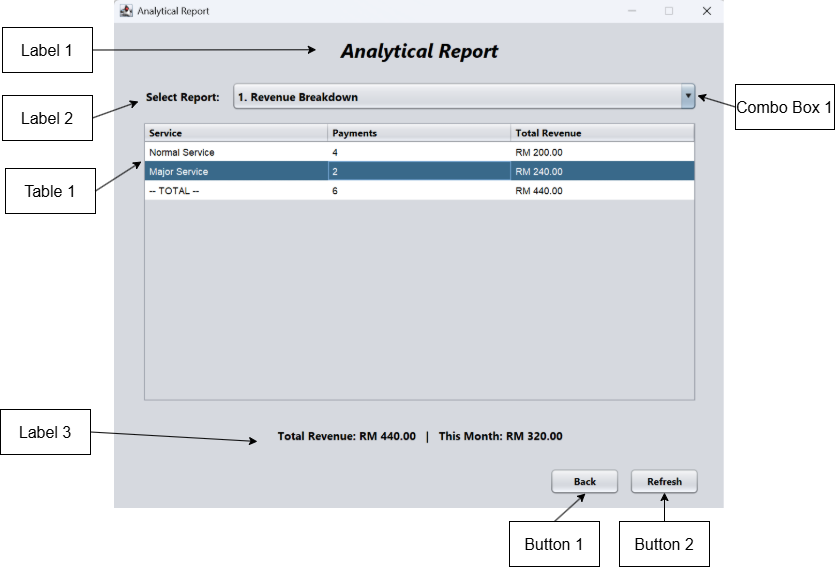 |
| *Dashboard with staff and customer counts* | *Analytical reports, with a report picker* |

### Counter Staff

| | |
|---|---|
| 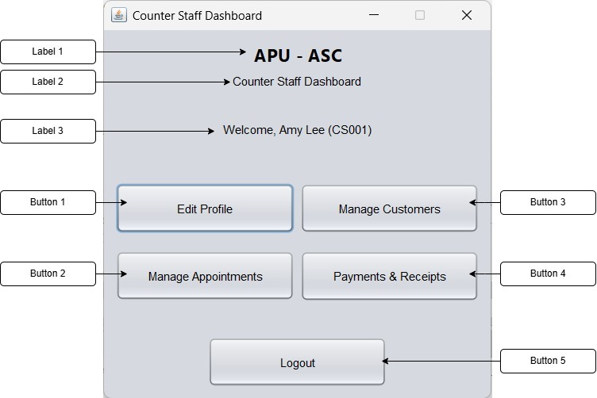 | 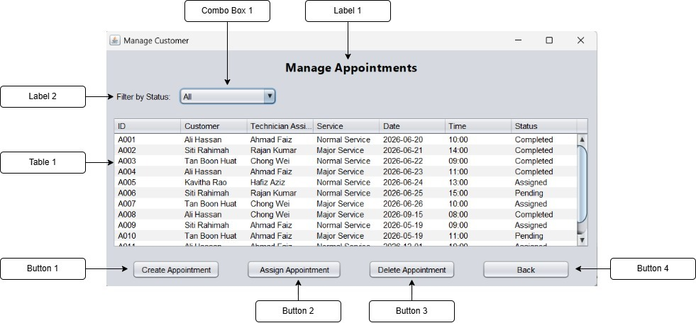 |
| *Dashboard* | *Appointments, filtered by status* |
| 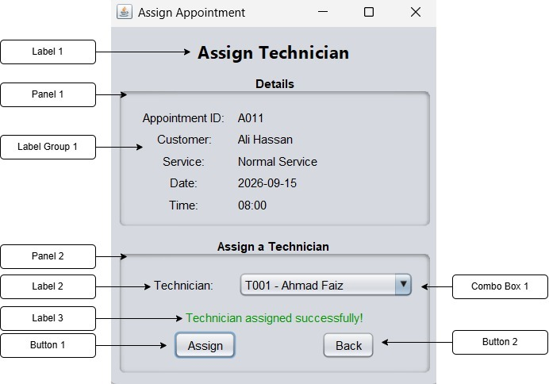 | 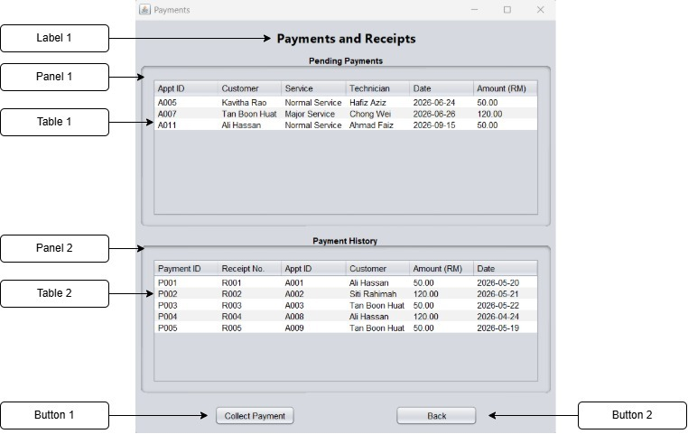 |
| *Assigning an available technician* | *Pending payments and payment history* |

### Technician

| | |
|---|---|
| 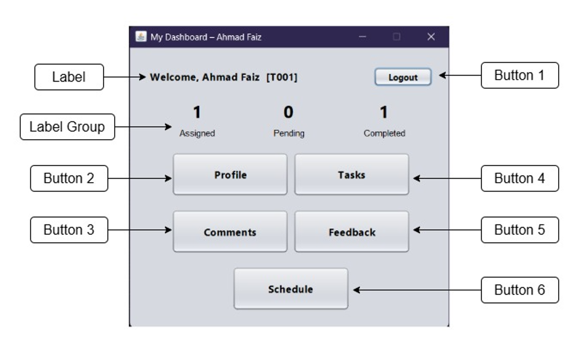 | 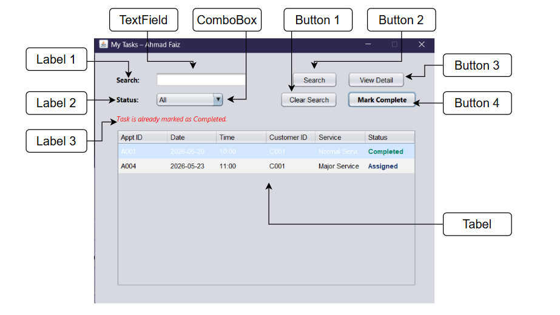 |
| *Dashboard with task counts* | *Assigned tasks, with search, filter and mark complete* |

### Customer

| | |
|---|---|
| 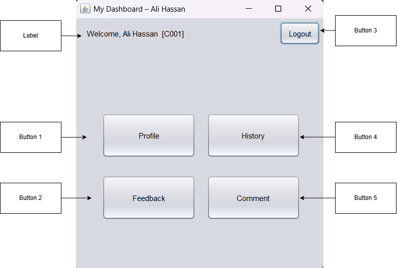 | 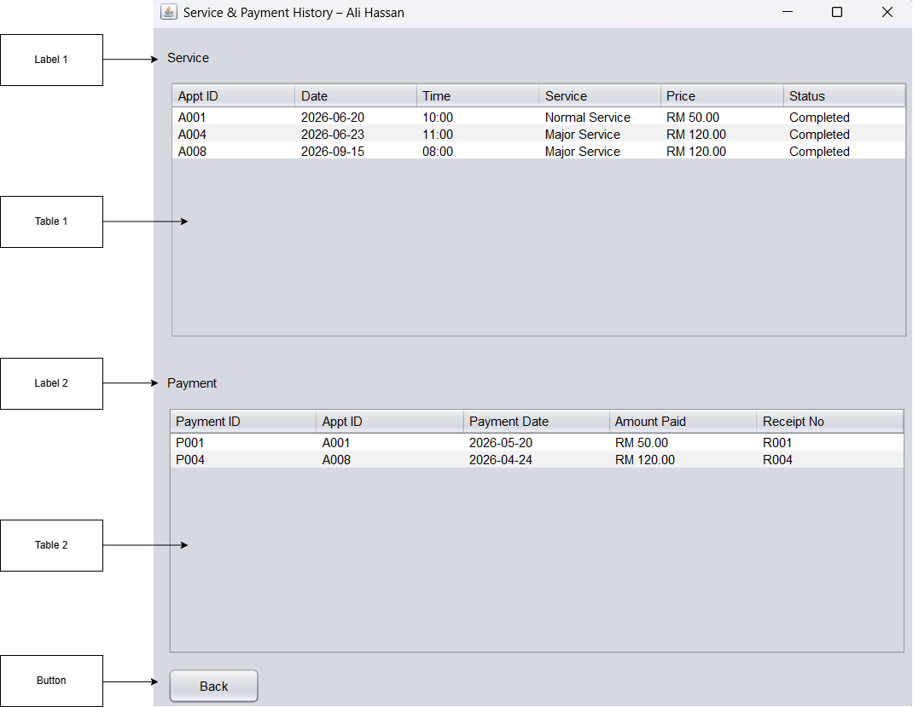 |
| *Dashboard* | *Service history and payment history* |

The boxed labels and arrows on the screenshots come from the project's user manual, where they explain each control.

## Design

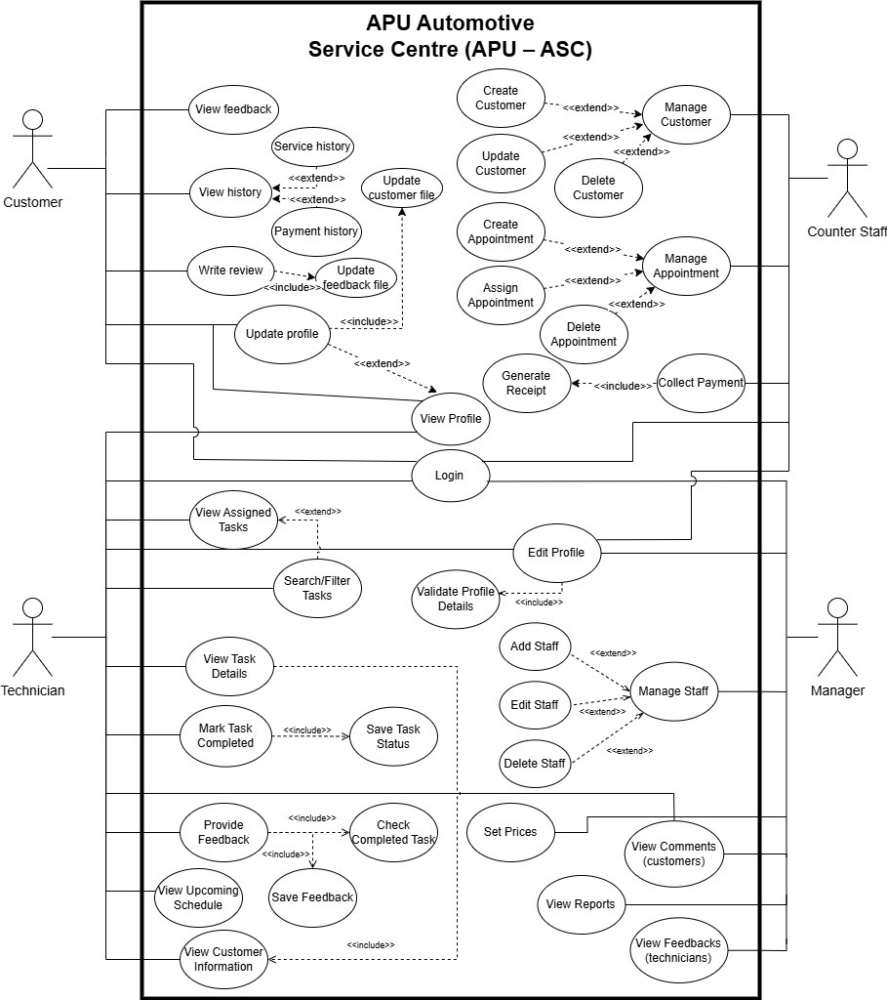

*Use case diagram for the four roles. The [full class diagram](docs/diagrams/class-diagram.png) is also available.*

The code is split into four layers:

| Layer | Package | What it holds |
|---|---|---|
| Model | `apu.asc.staff` | Entity classes: `User`, `Customer`, `Technician`, `CounterStaff`, `Manager`, `Appointment`, `Service`, `Payment`, `Feedback`, `Comment` |
| Helper | `apu.asc.staff` | `BaseFileHelper`, which does all file reading and writing, ID lookups and input validation |
| Service | `apu.asc.manager`, `counterstaff`, `technician`, `customer` | One service class per role (`ManagerService`, `csService`, `TechnicianService`, `CustomerService`) with that role's business rules |
| Boundary | the same four packages | Swing forms, each using its role's service class |

Login is handled by `apu.asc.main.LoginFrame` and `LoginService`, which open the right dashboard for the user's role.

### Object-oriented concepts

- **Abstraction:** `User` is an abstract class, and the interfaces `Displayable` and `FileStorable` define what every entity must provide.
- **Encapsulation:** fields are private or protected. Fields that must never change after creation, such as an appointment's ID or customer, have no setters.
- **Inheritance:** `Manager`, `CounterStaff`, `Technician` and `Customer` extend `User`. The four service classes extend `BaseFileHelper`.
- **Polymorphism:** each entity overrides `getDisplayInfo()` and `toFileString()`, and one staff screen handles all three staff types.
- **Modularity:** each role owns its package and service class, so a change to payments does not touch the technician module.

## Rules the system enforces

- Appointments are on weekdays between 9:00 and 17:00, with no past dates and only up to the end of next week
- A technician is shown as free unless they already have an assigned appointment overlapping that time
- Payments only for assigned appointments, and only one payment per appointment
- Technicians can only complete assigned appointments, and give one feedback per appointment
- IDs are generated by the system (`C001`, `T001`, `A001`, `P001`, `R001`) and are never reused
- Input is validated: phone numbers of 10 to 12 digits, ages from 0 to 100, an `@` in emails, no commas in names and addresses, usernames of at least 3 characters and passwords of at least 4

## Project structure

```
.
├── src/apu/asc/
│   ├── main/            LoginFrame, LoginService
│   ├── manager/         Manager screens and ManagerService
│   ├── counterstaff/    Counter staff screens and csService
│   ├── technician/      Technician screens and TechnicianService
│   ├── customer/        Customer screens and CustomerService
│   ├── staff/           Model classes and BaseFileHelper
│   └── Test/            TestAllClasses
├── Data/                Text files that act as the database
├── docs/                Screenshots and diagrams
└── nbproject/           NetBeans project files
```

About 12,000 lines of Java, with the Swing forms built in the NetBeans GUI designer.

## Data storage

All data lives in comma-separated text files in `Data/`: `users`, `customers`, `technicians`, `counterstaff`, `managers`, `services`, `appointments`, `payments`, `feedback` and `comments`. Lines starting with `#` are header comments and are ignored. The files are read and written relative to the folder the program is started from, so **run it from the repository root**.

## Getting started

You need **JDK 17 or newer**.

### NetBeans
Open the project folder in NetBeans and run it. The main class is `apu.asc.main.LoginFrame`.

### Command line
From the repository root:

```bash
javac --release 17 -d out -sourcepath src src/apu/asc/main/LoginFrame.java
java -cp out apu.asc.main.LoginFrame
```

### Demo accounts

All accounts and data are fictional.

| Role | Username | Password |
|---|---|---|
| Manager | `manager1` | `pass123` |
| Counter Staff | `counter1` | `abc123` |
| Technician | `tech1` | `techpass` |
| Customer | `ali123` | `pass123` |

The app saves every change straight back to the files in `Data/`.

## Testing

`apu.asc.Test.TestAllClasses` is a manual test program that prints the result of each check. It covers the model classes, the service methods (including error cases), the login, and it opens the Swing forms. It needs a display, and it **edits the files in `Data/`** as it runs, so use it on a copy of the project, or run `git restore Data` afterwards. Some steps use fixed dates, such as a booking for 2026-12-01 that the app now rejects because it is too far ahead, so those steps need updating before the whole run completes.

## Known limitations

- **Plain text storage.** There is no database and no protection against two people editing the same file at once.
- **Passwords are stored as plain text** in `users.txt`. A real system should hash them.
- Dates and times are typed in by hand, with no date picker.
- There is no session timeout, and customers cannot search their history.

## Team

| Role | Member |
|---|---|
| Manager | [@2FoR1](https://github.com/2FoR1) |
| Counter Staff | [@Xylore9](https://github.com/Xylore9) |
| Technician | [@xiulailai](https://github.com/xiulailai) |
| Customer | [@WilliamChuah](https://github.com/WilliamChuah) |

## License

Released under the [MIT License](LICENSE). Copyright (c) 2026 automaticicemaker Contributors and APU.
